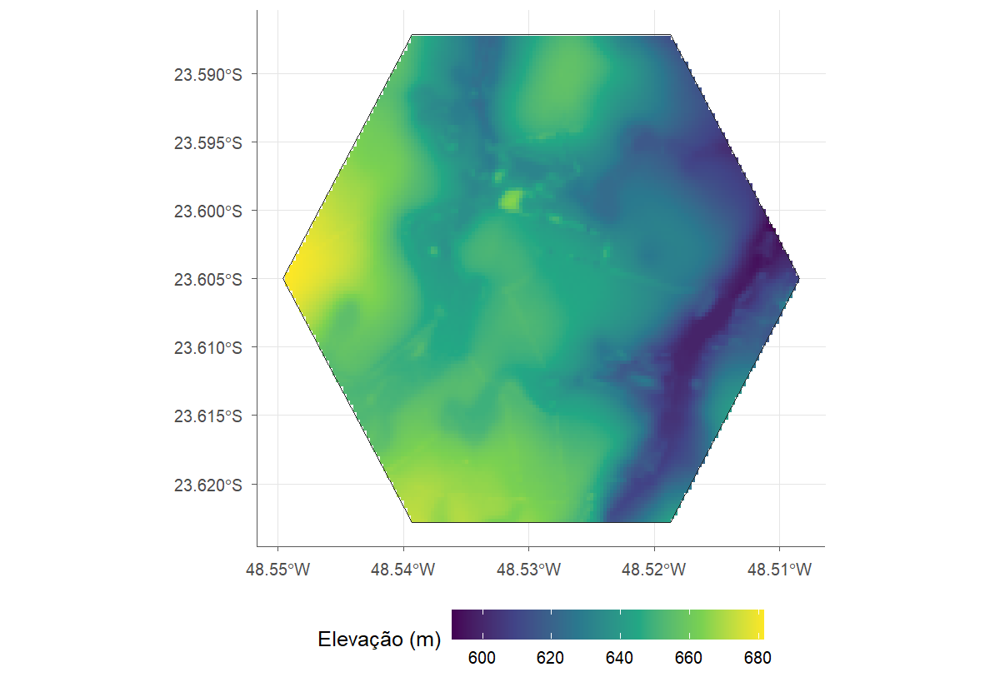
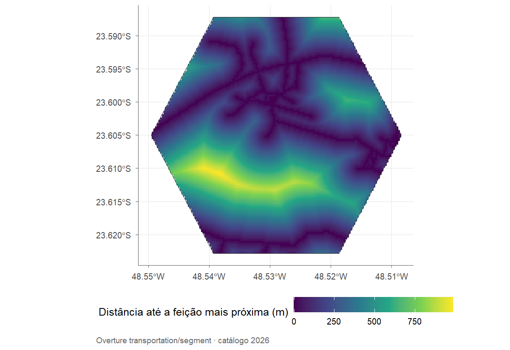
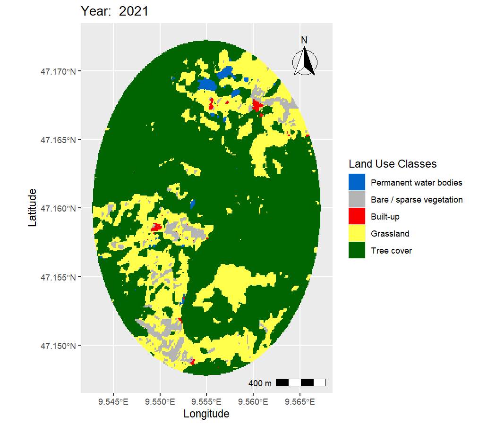

# (PART\*) Além do MapBiomas {-}

# Camadas externas {#camadas}

As funções de camadas externas recebem o mesmo objeto de mapas e devolvem os
resultados alinhados à mesma área, grade e sistema de coordenadas. Como dependem
de servidores públicos, as figuras deste capítulo foram geradas uma vez e
guardadas junto com o livro.

## Relevo e vias na Lagoa do Sino {-}

`load_physical()` traz a altitude, a declividade e a orientação do Copernicus
DEM, além de propriedades do solo do SoilGrids (argila, areia, silte, carbono,
pH e outras), já reamostradas para a grade dos mapas. Em conexões lentas, vale
ampliar o tempo limite, que por padrão é de 5 segundos:

```{r eval=FALSE}
relevo <- load_physical(mapas, layers = c("elevation", "slope"), timeout = 30)
relevo$plots$elevation
```

```{r gerar-relevo, include=FALSE, eval=!file.exists("imagens/lagoa-altitude.png")}
relevo <- load_physical(mapas, layers = c("elevation", "slope"), timeout = 30)
ggplot2::ggsave("imagens/lagoa-altitude.png", relevo$plots$elevation, width = 8, height = 5.5, dpi = 150)
```

```{r echo=FALSE, fig.cap="Altitude (Copernicus DEM, 30 m) na grade dos mapas da Lagoa do Sino."}

```

`load_features()` busca feições no Overture Maps ou em extratos regionais do
OpenStreetMap, e `feature_raster()` as transforma em superfícies na grade da
análise: distância, contagem, comprimento, cobertura ou densidade.

```{r eval=FALSE}
vias <- load_features(mapas, "roads", source = "overture")
distancia <- feature_raster(vias, mapas, feature = "roads",
                            metrics = "distance")
distancia$plots$distance
```

```{r gerar-vias, include=FALSE, eval=!file.exists("imagens/lagoa-distancia-vias.png")}
vias <- load_features(mapas, "roads", source = "overture")
distancia <- feature_raster(vias, mapas, feature = "roads", metrics = "distance")
ggplot2::ggsave("imagens/lagoa-distancia-vias.png", distancia$plots$distance, width = 8, height = 5.5, dpi = 150)
```

```{r echo=FALSE, fig.cap="Distância até a via mais próxima (Overture Maps) na Lagoa do Sino."}

```

Para pontos de campo, `distance_to_nearest()` mede a distância geodésica até a
feição ou a classe de uso mais próxima. Quando o alvo é uma classe dos próprios
mapas, nem é preciso internet:

```{r}
pontos <- data.frame(lon = c(-48.529, -48.515), lat = c(-23.605, -23.590))
ate_floresta <- distance_to_nearest(pontos, mapas, classes = 3)
```

O centro do campus fica a `r num(ate_floresta$distance_m[1], 0)` m da formação
florestal mais próxima, e o segundo ponto, a
`r num(ate_floresta$distance_m[2], 0)` m. A mesma função aceita as feições de
`load_features()`, como em `distance_to_nearest(pontos, vias, feature = "roads")`.

## Fora do Brasil: Liechtenstein {-}

`load_lulc()` lê o ESA WorldCover (10 m, 2020 e 2021) em qualquer lugar do mundo
e devolve um objeto igual ao de `load_rasters()`. Um exemplo mínimo, perto de
Vaduz, em Liechtenstein:

```{r eval=FALSE}
area <- make_polygon(lat = 47.16, lon = 9.555, size = 2, shape = "circle")
cobertura <- load_lulc(area$polygon, years = 2021)
land_vis(cobertura, year = 2021)
```

```{r gerar-liechtenstein, include=FALSE, eval=!file.exists("imagens/liechtenstein-worldcover.png")}
area <- make_polygon(lat = 47.16, lon = 9.555, size = 2, shape = "circle")
cobertura <- load_lulc(area$polygon, years = 2021)
ggplot2::ggsave("imagens/liechtenstein-worldcover.png", land_vis(cobertura, year = 2021),
                width = 7, height = 6, dpi = 150)
```

```{r echo=FALSE, out.width="80%", fig.cap="Cobertura da terra (ESA WorldCover 2021) perto de Vaduz, Liechtenstein."}

```

Como o formato é o mesmo, `get_area()`, `class_diversity()`, `land_change()` e
`fragment_metrics()` funcionam sem nenhuma mudança, agora com a legenda oficial
do WorldCover (`dict_build("esa_worldcover")`).
