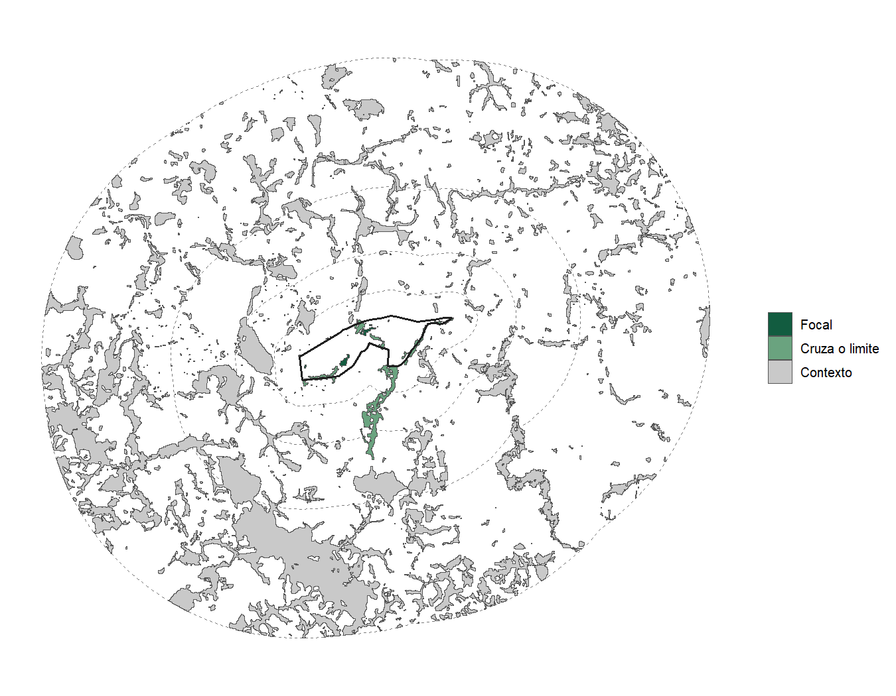
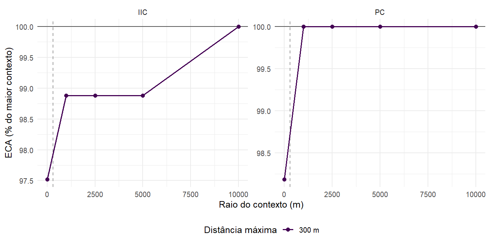
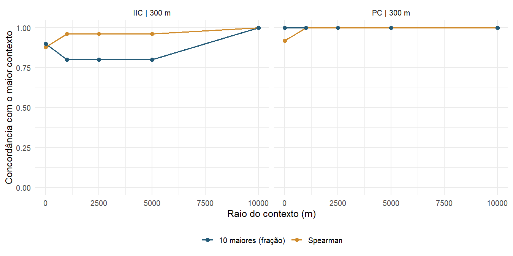
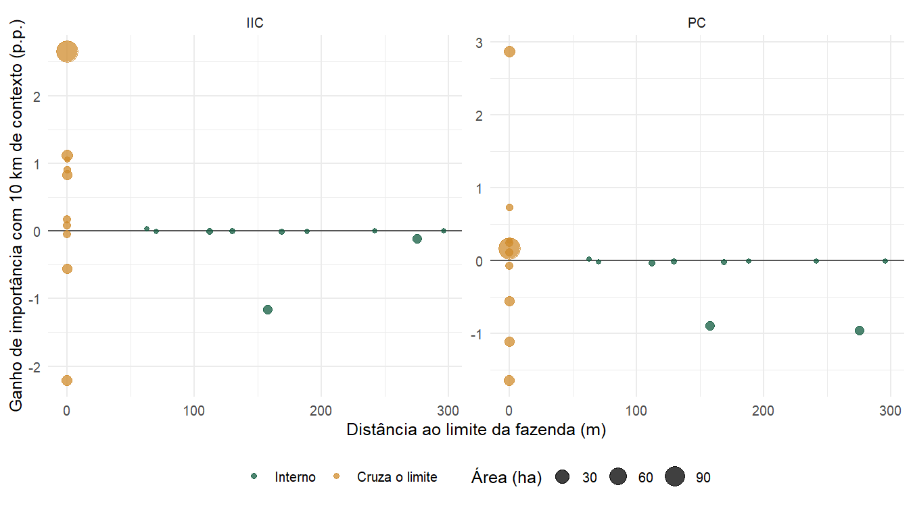
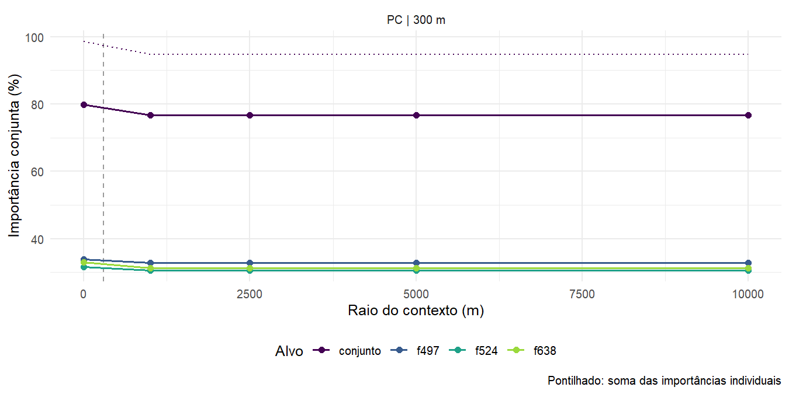

# Efeito de borda e contexto ampliado {#lagoa-contexto}

O limite da fazenda corta fragmentos e esconde os trampolins que ficam do lado
de fora. Por isso, a conectividade medida só dentro da área de estudo pode estar
subestimada perto da borda, e a ordem dos fragmentos prioritários pode depender
do recorte. Este capítulo mede esse efeito na Lagoa do Sino, com o entorno de até
10 km como contexto.

```{r contexto-dados, include=FALSE}
arquivo_contexto <- "imagens/contexto-lagoa.rds"
ctx <- if (file.exists(arquivo_contexto)) readRDS(arquivo_contexto)
tem_contexto <- !is.null(ctx)
if (tem_contexto) {
  s <- ctx$sensitivity
  pc <- s[s$metric == "PC", ]
  iic <- s[s$metric == "IIC", ]
  rs <- ctx$rank_stability
}
```

```{r echo=FALSE, eval=!tem_contexto, results="asis"}
cat("::: {.atencao}\nAs figuras deste capítulo são geradas uma vez, com",
    "`Rscript development/gerar_figuras_contexto.R`, e ainda não estão em `imagens/`.\n:::\n")
```

## Área focal e contexto {-}

Com uma área focal, `land_connectivity()` mede a conectividade do habitat da
área de estudo usando o entorno como trampolim: cada fragmento entra com a sua
área dentro da área focal, os de fora valem só como ligação e o denominador
continua sendo a área de estudo. Assim, os índices calculados com contextos de
tamanhos diferentes são comparáveis.

`connectivity_context()` repete a análise para vários raios. A partir dos mapas e
das classes de habitat, ela amplia a área com o maior raio, recarrega os mapas
pela mesma via de aquisição (aqui, a leitura por HTTP), reclassifica e vetoriza
uma única vez e reaproveita as distâncias do maior contexto nos menores. O raio 0
é a análise sem contexto, igual à do capítulo \@ref(lagoa-conectividade):

```{r eval=FALSE}
mapas_2024 <- load_rasters(ufscar, start = 2024, end = 2024, method = "http",
                           product = "mapbiomas_brasil_c10")
contexto <- connectivity_context(mapas_2024, classes = 3, max_dist = 300,
  context = c(0, 1000, 2500, 5000, 10000), metric_patch = c("IIC", "PC"),
  d_ref = 150, parallel = 4)
```

```{r echo=FALSE, eval=tem_contexto, out.width="85%", fig.cap="Fazenda Lagoa do Sino (contorno preto) e os raios de contexto (tracejado). Em verde, os fragmentos de floresta da fazenda; em cinza, os do entorno."}

```

## Sensibilidade dos índices {-}

Os índices só crescem com o raio, porque mais trampolins só encurtam caminhos.
Quando a curva se estabiliza (`converged`), o contexto deixa de mudar o
resultado; se ela ainda cresce no maior raio, o efeito de borda persiste.

```{r echo=FALSE, eval=tem_contexto, fig.cap="ECA de cada raio em relação à do maior contexto. A linha tracejada marca a distância máxima de 300 m."}

```

```{r echo=FALSE, eval=tem_contexto}
tabela(data.frame(`Raio (m)` = s$radius_m, Índice = s$metric, Fragmentos = s$patches,
                  `ECA (ha)` = s$ECA_ha, ProtConn = s$ProtConn,
                  `Variação (%)` = s$ECA_change, check.names = FALSE), 2)
```

```{r include=FALSE, eval=tem_contexto}
ganho_pc <- 100 * (max(pc$ECA_ha) / pc$ECA_ha[1] - 1)
raio_estavel <- min(pc$radius_m[abs(pc$ECA_change) < 0.01])
```

Na Lagoa do Sino, o entorno de `r if (tem_contexto) max(ctx$raios) / 1000` km soma
`r if (tem_contexto) ctx$fragmentos[["contexto"]] - ctx$fragmentos[["fazenda"]]`
fragmentos aos `r if (tem_contexto) ctx$fragmentos[["fazenda"]]` da fazenda, mas a
ECA do PC sobe só `r if (tem_contexto) num(ganho_pc)`% e se estabiliza a partir de
`r if (tem_contexto) num(raio_estavel / 1000, 1)` km: o grande fragmento interno
domina o índice. O IIC, que não decai com a distância, ainda varia entre os maiores
raios. Em áreas pequenas, estreitas ou com floresta espalhada, o efeito costuma
ser maior.

## Estabilidade da priorização {-}

`rank_stability` compara, raio a raio, a ordem dos fragmentos da fazenda com a do
maior contexto: correlação de Spearman e sobreposição dos 10 mais importantes.

```{r echo=FALSE, eval=tem_contexto, fig.cap="Concordância da priorização dos fragmentos da fazenda com a do maior contexto."}

```

## Efeito de borda por fragmento {-}

Os fragmentos que cruzam o limite da fazenda são os que mais mudam com o
contexto: sem ele, entram cortados, e o contexto devolve a sua forma inteira e
os vizinhos de fora. Alguns ganham importância e outros perdem, porque a
importância é relativa ao índice, que também cresce. Os fragmentos internos
quase não mudam:

```{r echo=FALSE, eval=tem_contexto, fig.cap="Ganho de importância de cada fragmento da fazenda entre a análise sem contexto e a de 10 km, em função da distância ao limite."}

```

## Trampolins fora da fazenda {-}

`stepping_stones` lista os fragmentos do entorno que sustentam a conectividade
da fazenda. Eles têm área zero na análise focal, então sua importância é só de
conector. Com floresta a 300 m, só o IIC encontra trampolins externos: pelo
número de passos, uma cadeia de fragmentos de fora liga a fazenda ao grande
fragmento vizinho. No PC, a probabilidade decai com a distância, e o ganho vem
de contar inteiros os fragmentos que cruzam o limite, não de trampolins:

```{r echo=FALSE, eval=tem_contexto}
st <- ctx$stepping
tabela(data.frame(Índice = st$metric, Fragmento = st$fragment_id, `Área (ha)` = st$area_ha,
                  `Conector (%)` = st$connector, check.names = FALSE), 2)
```

## Fragmentos-alvo {-}

Com `targets`, a análise mede a importância de um fragmento ou de um conjunto
deles removidos de uma vez, raio a raio. A diferença para a soma das importâncias
individuais (`interaction`) mostra se os fragmentos se substituem (positiva) ou
dividem a mesma contribuição (negativa). Os alvos podem ser `fragment_id`, listas
nomeadas de ids ou geometrias `sf`, inclusive fora da área de estudo:

```{r eval=FALSE}
ps <- contexto$patch_sensitivity
top <- head(ps$fragment_id[ps$metric == "PC" & ps$radius_m == 10000 & ps$rank <= 3], 3)
alvos <- connectivity_context(mapas_2024, classes = 3, max_dist = 300,
  context = c(0, 1000, 2500, 5000, 10000), metric_patch = "PC", d_ref = 150,
  targets = c(list(conjunto = top), setNames(as.list(top), paste0("f", top))))
alvos$target_sensitivity
alvos$target_plot
```

Na Lagoa do Sino, os três fragmentos mais importantes dividem contribuições: a
importância conjunta fica abaixo da soma das individuais (interação negativa),
porque os pares entre eles entram duas vezes na soma.

```{r echo=FALSE, eval=tem_contexto, fig.cap="Importância conjunta dos três fragmentos mais importantes da fazenda e de cada um deles; em pontilhado, a soma das importâncias individuais."}

```

## Um único contexto {-}

Sem a curva de sensibilidade, basta ler os mapas com `context_m` (capítulo
\@ref(aquisicao)): os polígonos herdam a área focal, e `land_connectivity()` a
usa sozinha. A análise funciona com qualquer via de aquisição: MapBiomas por
recortes ou por HTTP, ESA WorldCover (`load_lulc()`) e pastas locais
(`load_local_rasters()`), de qualquer país.

::: {.nota}
As figuras e tabelas deste capítulo foram geradas uma vez, neste mesmo fluxo,
por `development/gerar_figuras_contexto.R` (cerca de 3 min com internet) e ficam
em `imagens/`; o livro só as exibe.
:::
