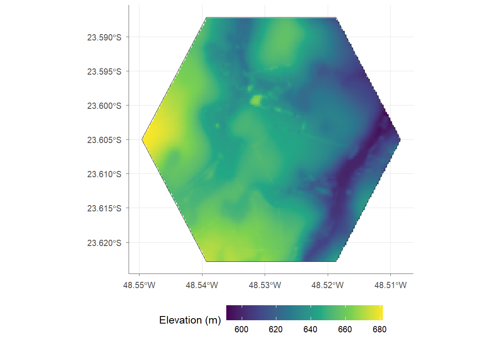
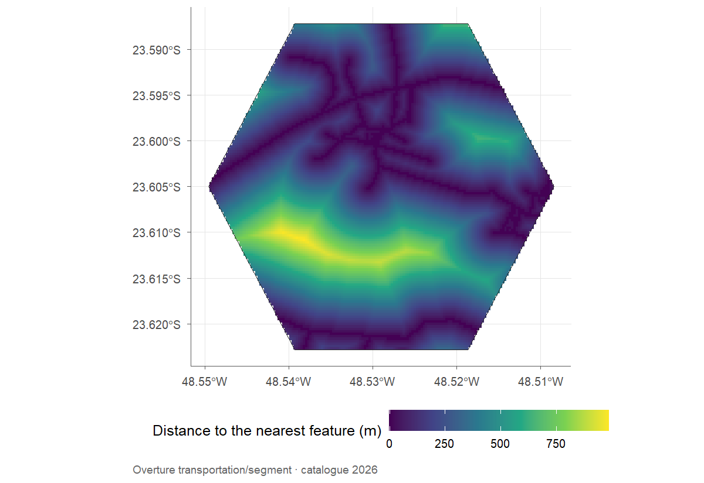

# (PART\*) Beyond MapBiomas {-}

# External layers {#external-layers}

The external-layer functions take the same maps object and return results
aligned to the same area, grid and coordinate reference system. Because they
depend on public servers, the figures in this chapter were generated once and
stored with the book.

## Terrain and roads at Lagoa do Sino {-}

`load_physical()` brings elevation, slope and aspect from the Copernicus DEM, as
well as soil properties from SoilGrids (clay, sand, silt, carbon, pH and
others), already resampled to the map grid. On slow connections, it is worth
raising the time limit, which defaults to 5 seconds:

```{r eval=FALSE}
terrain <- load_physical(maps, layers = c("elevation", "slope"), timeout = 30,
                         language = "en")
terrain$plots$elevation
```

```{r make-terrain, include=FALSE, eval=!file.exists("../imagens/en-lagoa-elevation.png")}
terrain <- load_physical(maps, layers = c("elevation", "slope"), timeout = 30, language = "en")
ggplot2::ggsave("../imagens/en-lagoa-elevation.png", terrain$plots$elevation, width = 8, height = 5.5, dpi = 150)
```

```{r echo=FALSE, fig.cap="Elevation (Copernicus DEM, 30 m) on the Lagoa do Sino map grid."}

```

`load_features()` retrieves features from Overture Maps or from regional
OpenStreetMap extracts, and `feature_raster()` turns them into surfaces on the
analysis grid: distance, count, length, coverage or density.

```{r eval=FALSE}
roads <- load_features(maps, "roads", source = "overture")
distance <- feature_raster(roads, maps, feature = "roads", metrics = "distance",
                           language = "en")
distance$plots$distance
```

```{r make-roads, include=FALSE, eval=!file.exists("../imagens/en-lagoa-road-distance.png")}
roads <- load_features(maps, "roads", source = "overture")
distance <- feature_raster(roads, maps, feature = "roads", metrics = "distance", language = "en")
ggplot2::ggsave("../imagens/en-lagoa-road-distance.png", distance$plots$distance, width = 8, height = 5.5, dpi = 150)
```

```{r echo=FALSE, fig.cap="Distance to the nearest road (Overture Maps) at Lagoa do Sino."}

```

For field points, `distance_to_nearest()` measures the geodesic distance to the
nearest feature or land use class. When the target is a class from the maps
themselves, no internet connection is needed:

```{r}
points <- data.frame(lon = c(-48.529, -48.515), lat = c(-23.605, -23.590))
to_forest <- distance_to_nearest(points, maps, classes = 3)
```

The centre of the campus is `r num(to_forest$distance_m[1], 0)` m from the
nearest forest formation, and the second point is
`r num(to_forest$distance_m[2], 0)` m away. The same function also takes the
features from `load_features()`, as in
`distance_to_nearest(points, roads, feature = "roads")`.

## Outside Brazil: Liechtenstein {-}

`load_lulc()` reads ESA WorldCover (10 m, 2020 and 2021) anywhere in the world
and returns an object identical in structure to that of `load_rasters()`. A
minimal example, near Vaduz, Liechtenstein:

```{r eval=FALSE}
area <- make_polygon(lat = 47.16, lon = 9.555, size = 2, shape = "circle")
cover <- load_lulc(area$polygon, years = 2021)
land_vis(cover, year = 2021)
```

```{r echo=FALSE, out.width="80%", fig.cap="Land cover (ESA WorldCover 2021) near Vaduz, Liechtenstein."}
knitr::include_graphics("../imagens/liechtenstein-worldcover.png")
```

Since the format is the same, `get_area()`, `class_diversity()`, `land_change()`
and `fragment_metrics()` work unchanged, now with the official WorldCover legend
(`dict_build("esa_worldcover")`).
