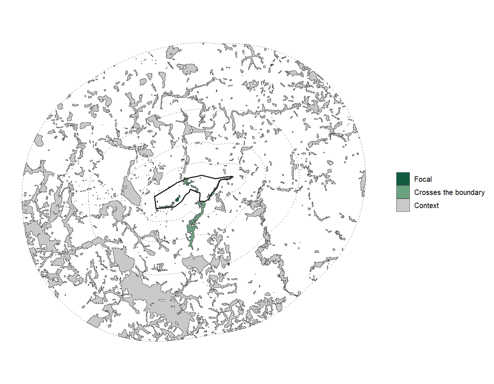
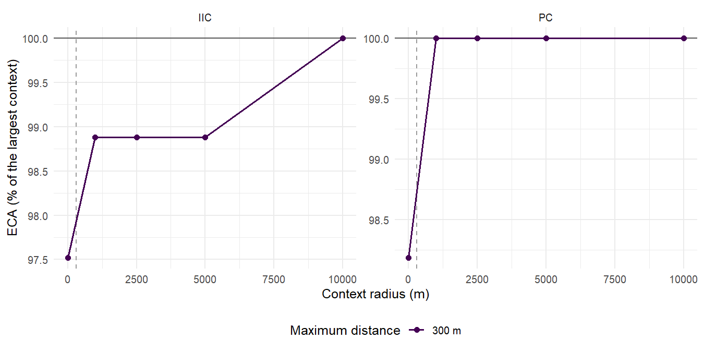
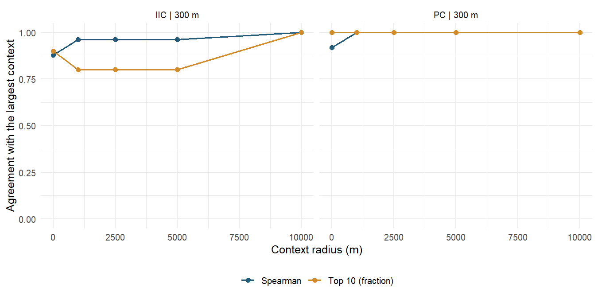
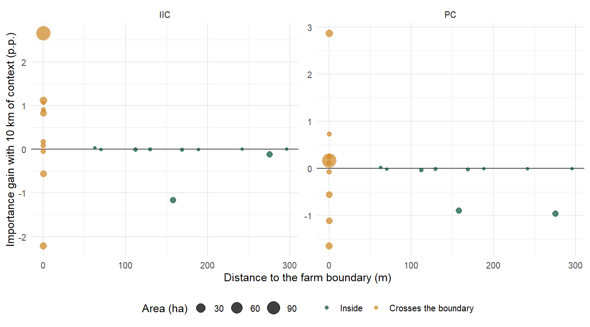
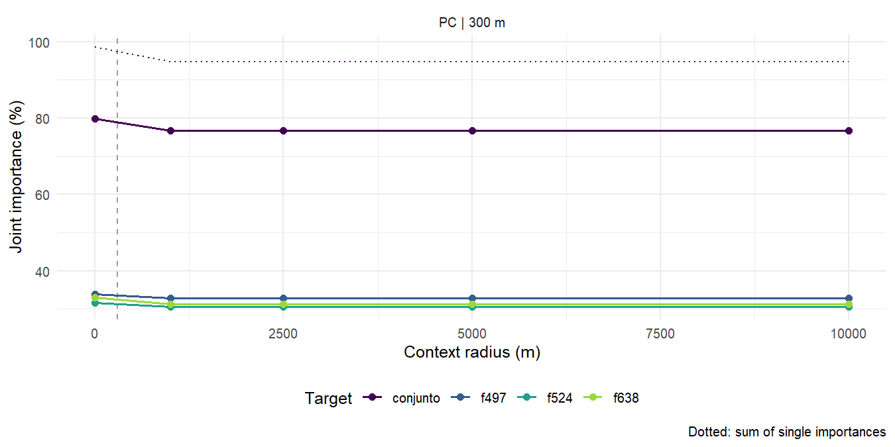

# Edge effects and an extended context {#lagoa-context}

The farm boundary cuts fragments and hides the stepping stones outside it. The
connectivity measured only inside the study area can therefore be underestimated
near the edge, and the order of priority fragments can depend on the clip. This
chapter measures that effect at Lagoa do Sino, with up to 10 km of surroundings as
context.

```{r context-data, include=FALSE}
context_file <- "../imagens/contexto-lagoa.rds"
ctx <- if (file.exists(context_file)) readRDS(context_file)
has_context <- !is.null(ctx)
if (has_context) {
  s <- ctx$sensitivity
  pc <- s[s$metric == "PC", ]
  rs <- ctx$rank_stability
}
```

```{r echo=FALSE, eval=!has_context, results="asis"}
cat("::: {.atencao}\nThe figures of this chapter are generated once, with",
    "`Rscript development/gerar_figuras_contexto.R`, and are not yet in `imagens/`.\n:::\n")
```

## Focal area and context {-}

With a focal area, `land_connectivity()` measures the connectivity of the study
area's habitat using its surroundings as stepping stones: each fragment counts
with its area inside the focal area, those outside count only as links, and the
denominator is still the study area. Indices computed with contexts of different
sizes are therefore comparable.

`connectivity_context()` repeats the analysis for several radii. From the maps and
the habitat classes, it extends the area by the largest radius, reloads the maps
through the same acquisition route (here, HTTP reading), reclassifies and
vectorizes once, and reuses the distances of the largest context for the smaller
ones. Radius 0 is the analysis without context, the same as in chapter
\@ref(lagoa-connectivity):

```{r eval=FALSE}
maps_2024 <- load_rasters(ufscar, start = 2024, end = 2024, method = "http",
                          product = "mapbiomas_brasil_c10")
context <- connectivity_context(maps_2024, classes = 3, max_dist = 300,
  context = c(0, 1000, 2500, 5000, 10000), metric_patch = c("IIC", "PC"),
  d_ref = 150, parallel = 4, language = "en")
```

```{r echo=FALSE, eval=has_context, out.width="85%", fig.cap="Lagoa do Sino farm (black outline) and the context radii (dashed). Green: forest fragments of the farm; grey: those of the surroundings."}

```

## Sensitivity of the indices {-}

Indices only grow with the radius, because more stepping stones can only shorten
paths. When the curve levels off (`converged`), the context no longer changes the
result; if it still grows at the largest radius, the edge effect persists.

```{r echo=FALSE, eval=has_context, fig.cap="ECA of each radius relative to that of the largest context. The dashed line marks the maximum distance of 300 m."}

```

```{r echo=FALSE, eval=has_context}
tabela(data.frame(`Radius (m)` = s$radius_m, Index = s$metric, Fragments = s$patches,
                  `ECA (ha)` = s$ECA_ha, ProtConn = s$ProtConn,
                  `Change (%)` = s$ECA_change, check.names = FALSE), 2)
```

```{r include=FALSE, eval=has_context}
pc_gain <- 100 * (max(pc$ECA_ha) / pc$ECA_ha[1] - 1)
stable_radius <- min(pc$radius_m[abs(pc$ECA_change) < 0.01])
```

At Lagoa do Sino, the `r if (has_context) max(ctx$raios) / 1000` km surroundings add
`r if (has_context) ctx$fragmentos[["contexto"]] - ctx$fragmentos[["fazenda"]]`
fragments to the farm's `r if (has_context) ctx$fragmentos[["fazenda"]]`, but the PC
ECA rises only `r if (has_context) num(pc_gain)`% and levels off from
`r if (has_context) num(stable_radius / 1000, 1)` km: the large inner fragment
dominates the index. IIC, which does not decay with distance, still changes
between the largest radii. In small or narrow areas, or with scattered forest, the
effect is usually larger.

## Stability of the ranking {-}

`rank_stability` compares, radius by radius, the order of the farm's fragments
with that of the largest context: Spearman correlation and overlap of the top 10.

```{r echo=FALSE, eval=has_context, fig.cap="Agreement of the ranking of the farm's fragments with that of the largest context."}

```

## Edge effect by fragment {-}

The fragments that cross the farm boundary change most with the context: without
it they come in clipped, and the context restores their whole shape and their
outside neighbours. Some gain importance and others lose it, because importance is
relative to the index, which also grows. Inner fragments barely change:

```{r echo=FALSE, eval=has_context, fig.cap="Importance gain of each farm fragment between the analysis without context and the 10 km one, against its distance to the boundary."}

```

## Stepping stones outside the farm {-}

`stepping_stones` lists the fragments of the surroundings that sustain the farm's
connectivity. They have zero area in the focal analysis, so their importance is
only that of a connector. With forest at 300 m, only IIC finds outside stepping
stones: by number of steps, a chain of outside fragments links the farm to the
large neighbouring fragment. In PC, probability decays with distance, and the gain
comes from counting whole the fragments that cross the boundary, not from stepping
stones:

```{r echo=FALSE, eval=has_context}
st <- ctx$stepping
tabela(data.frame(Index = st$metric, Fragment = st$fragment_id, `Area (ha)` = st$area_ha,
                  `Connector (%)` = st$connector, check.names = FALSE), 2)
```

## Target fragments {-}

With `targets`, the analysis measures the importance of a fragment or of a set of
fragments removed at once, radius by radius. The difference from the sum of single
importances (`interaction`) shows whether the fragments substitute for each other
(positive) or share the same contribution (negative). Targets can be
`fragment_id`, named lists of ids or `sf` geometries, including outside the study
area:

```{r eval=FALSE}
ps <- context$patch_sensitivity
top <- head(ps$fragment_id[ps$metric == "PC" & ps$radius_m == 10000 & ps$rank <= 3], 3)
targets <- connectivity_context(maps_2024, classes = 3, max_dist = 300,
  context = c(0, 1000, 2500, 5000, 10000), metric_patch = "PC", d_ref = 150,
  targets = c(list(set = top), setNames(as.list(top), paste0("f", top))),
  language = "en")
targets$target_sensitivity
targets$target_plot
```

At Lagoa do Sino, the three most important fragments share contributions: their
joint importance is below the sum of the single ones (negative interaction),
because the pairs between them are counted twice in the sum.

```{r echo=FALSE, eval=has_context, fig.cap="Joint importance of the farm's three most important fragments and of each of them; dotted, the sum of single importances."}

```

## A single context {-}

Without the sensitivity curve, read the maps with `context_m` (chapter
\@ref(acquisition)): the polygons inherit the focal area and `land_connectivity()`
uses it on its own. The analysis works with any acquisition route: MapBiomas by
tiles or over HTTP, ESA WorldCover (`load_lulc()`) and local folders
(`load_local_rasters()`), from any country.

::: {.nota}
The figures and tables of this chapter were generated once, with this same flow,
by `development/gerar_figuras_contexto.R` (about 3 min with internet), and are kept
in `imagens/`; the book only displays them.
:::
