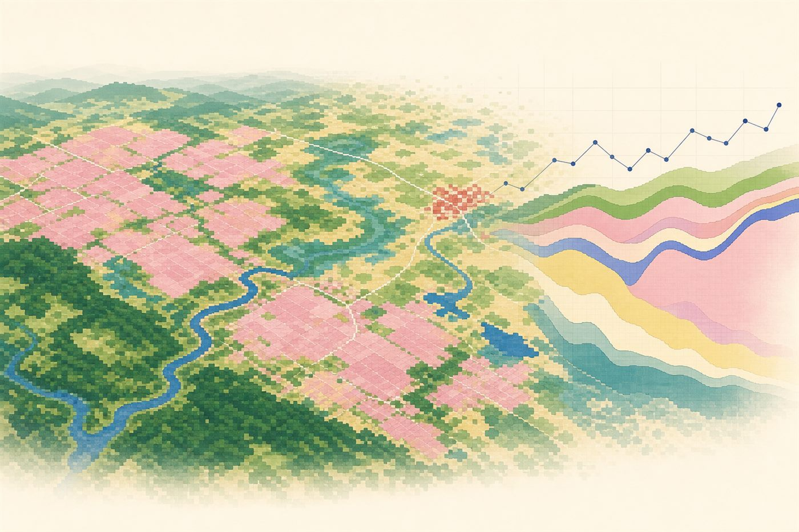

# Preface {-}

::: {.capa}
```{r cover, echo=FALSE}

```
:::

<span class="versao">version `r packageVersion("biomastats")`</span>

**Bioma Stats** (`biomastats`) is an R package that takes a land use and land
cover study from start to finish. You choose an area, and the package fetches
only the part of the [MapBiomas](https://mapbiomas.org) annual maps that covers
it. From there, each function answers a question about the landscape: how much
each class occupies, how diverse the landscape is, when the major changes
happened, how vegetation fragments are arranged and whether they are still
connected. Open layers on infrastructure, terrain and soils, including outside
Brazil, can be brought onto the same area and grid.

::: {.cartoes}
::: {.cartao}
**Selective acquisition**

Downloads only the MapBiomas tiles that cover the area, or crops a national collection already stored on your computer.
:::
::: {.cartao}
**Chained workflow**

Each function takes the previous result and inherits its classes, colours, units and time span.
:::
::: {.cartao}
**Landscape on the native grid**

Metrics and fragments are computed without reprojecting the maps, with geodesic areas and edges.
:::
::: {.cartao}
**Open layers**

ESA WorldCover, OpenStreetMap, Overture, Copernicus DEM and SoilGrids, aligned to the analysis grid.
:::
:::

## How to read this book {-}

The book has three parts. **Getting started** covers installation, introduces
every function and the data sources it uses, and shows the two ways of
obtaining MapBiomas maps. **Complete workflow: Lagoa do Sino** applies every
analysis, in sequence, to the UFSCar Lagoa do Sino campus in Buri, São Paulo,
and discusses what each result shows. **Beyond MapBiomas** covers external
layers, with one example in Brazil and another abroad.

All results in Part II were computed when this book was built, from the example
maps that ship with the package. Copy the code and you will get the same
figures and tables.

::: {.logos}
```{r logos, echo=FALSE, out.width="auto"}
knitr::include_graphics(c("../imagens/logo_ufscar.png", "../imagens/logo_cnpq.png"))
```
:::
